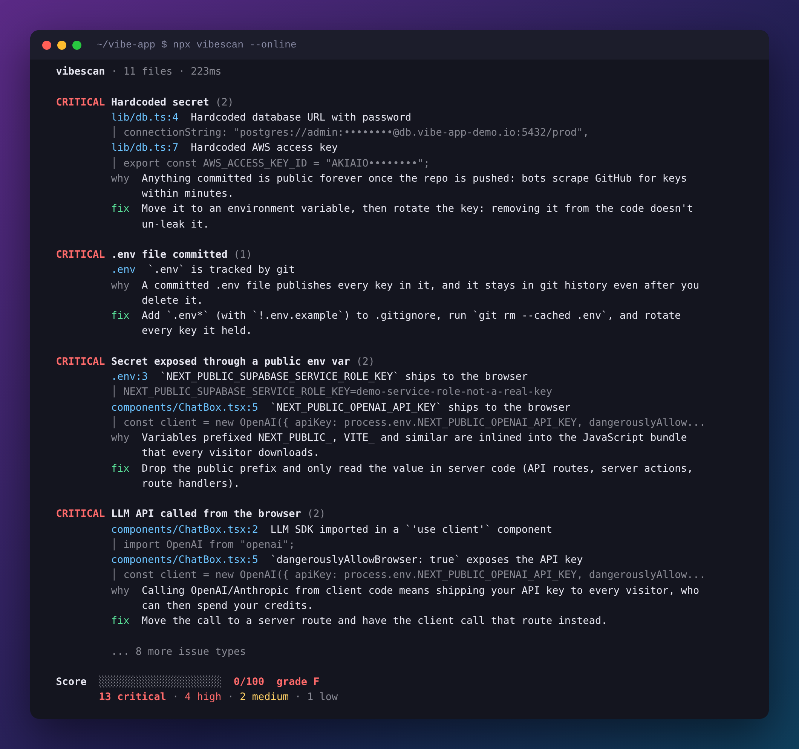

<h1 align="center">🔍 VibeCode Scanner</h1>

<p align="center">
  <b>Your AI wrote the app. Did it also leave the door open?</b><br/>
  A zero-dependency CLI and GitHub Action that catches the security mistakes vibe coding leaves behind.
</p>

<p align="center">
  <a href="https://github.com/franatucha/vibecode-scanner/actions/workflows/ci.yml"></a>
  
  
  
</p>

<p align="center"></p>

---

## Why

AI assistants are great at making things *work* and bad at making them *safe*. The same handful of mistakes shows up again and again in AI-generated projects: an OpenAI key in a client component, a `DELETE` route nobody protected, a Supabase table without row-level security, a package the model made up.

Generic linters don't look for these, and full SAST suites are overkill for a weekend project. `vibescan` targets exactly this list, explains each finding in plain English, and runs in under a second.

## Quick start

```bash
npx github:franatucha/vibecode-scanner --online
```

Run it from your project folder, or pass a path: `npx github:franatucha/vibecode-scanner ./my-app`.

## What it catches

| Severity | Rule | What it looks for |
|---|---|---|
| 🔴 critical | `secrets/hardcoded` | OpenAI, Anthropic, AWS, GitHub, Stripe, Google and Slack keys, private keys, DB URLs with passwords |
| 🔴 critical | `secrets/env-committed` | `.env` files tracked by git |
| 🔴 critical | `secrets/public-env` | Secrets behind `NEXT_PUBLIC_` / `VITE_` / `EXPO_PUBLIC_`, which get bundled into the browser |
| 🔴 critical | `ai/llm-in-browser` | LLM SDKs in `'use client'` components, `dangerouslyAllowBrowser: true` |
| 🔴 critical | `deps/hallucinated` | Dependencies that don't exist on npm or PyPI ("slopsquatting"), checked with `--online` |
| 🔴 critical | `db/open-access` | Firebase rules with `if true`, Supabase tables without row-level security |
| 🔴 critical | `injection/sql` | SQL built with template literals, `+`, f-strings, `$queryRawUnsafe` |
| 🟠 high | `auth/unprotected-route` | Next.js (App and Pages Router) and Express routes that write data without checking the caller |
| 🟠 high | `injection/xss` | `dangerouslySetInnerHTML` / `innerHTML` without sanitizing, `eval`, `new Function` |
| 🟡 medium | `web/cors-wildcard` | `origin: '*'`, `cors()` with defaults, `allow_origins=['*']` |
| 🟡 medium | `abuse/no-rate-limit` | Routes calling paid APIs (LLMs, email, SMS) in a project with no rate limiter |
| ⚪ low | `quality/no-tests` | No tests at all |

Every finding comes with **why it matters** and **how to fix it**. Secrets are masked in all output, so reports are safe to paste into an issue.

### Built to stay quiet when the code is fine

A scanner that cries wolf gets uninstalled. vibescan understands that:

- tagged templates such as `` sql`...${id}` `` and `` prisma.$queryRaw`...` `` are parameterized, not injectable
- a `middleware.ts` that checks auth protects every route under it
- webhook handlers that verify a signature are authenticated
- `<style dangerouslySetInnerHTML>` with generated CSS (as in shadcn/ui's chart) isn't XSS
- regexes and strings that *mention* `eval(` aren't calls to it, so the scanner scans itself clean

It was tuned against real production codebases until the only findings left were real ones.

## Options

```
vibescan [dir] [options]

  --online              Also check that every dependency exists on npm / PyPI
  --format <f>          pretty (default) | json | markdown | sarif
  --output, -o <file>   Write the report to a file instead of stdout
  --fail-on <sev>       Exit 1 if any finding is at least this severe
  --min-score <n>       Exit 1 if the score is below n
  --ignore <glob>       Skip matching paths (repeatable)
  --disable <rule>      Skip a rule by id (repeatable)
  --list-rules          Print every rule and exit
```

**Silencing:** add `// vibescan-ignore` on a line (or the line above it) for a reviewed exception, or list globs in a `.vibescanignore` file at the project root.

**Scoring:** each project starts at 100. Each rule that fires subtracts a penalty based on its severity (25 / 12 / 5 / 2). Repeats of the same rule count less, so one noisy rule can't zero the score on its own. Grades: A ≥ 90, B ≥ 75, C ≥ 60, D ≥ 40, F below.

## GitHub Action

```yaml
# .github/workflows/vibescan.yml
name: vibescan
on: [push, pull_request]

jobs:
  scan:
    runs-on: ubuntu-latest
    permissions:
      contents: read
      security-events: write   # only needed for the SARIF upload
    steps:
      - uses: actions/checkout@v4
      - uses: franatucha/vibecode-scanner@main
        with:
          fail-on: critical      # or high, medium, low; empty never fails
      - uses: github/codeql-action/upload-sarif@v3
        if: always()
        with:
          sarif_file: vibescan.sarif
```

The action writes a summary table to the job page. With the SARIF upload, findings also show up inline on pull requests and in the **Security → Code scanning** tab. It exposes `score` and `grade` as outputs if you want a badge or a PR comment.

## Try it on the demo

[`examples/vibe-app`](examples/vibe-app) is a small Next.js + Express app containing every mistake on the list (all keys are fake):

```bash
git clone https://github.com/franatucha/vibecode-scanner && cd vibecode-scanner
npm ci && npm run build
node dist/cli.js examples/vibe-app --online
```

## How it works

```
src/
├── cli.ts            argument parsing, exit codes
├── scan.ts           runs rules in parallel, sorts findings, computes the score
├── project.ts        file discovery: uses git when available, respects .gitignore and .vibescanignore
├── rules/
│   ├── secrets.ts    key formats, .env tracking, public env prefixes, masking
│   ├── web.ts        auth, SQL, CORS, XSS
│   └── project.ts    LLM-in-browser, open databases, hallucinated deps, rate limits, tests
└── report/           pretty terminal output, JSON, Markdown, SARIF 2.1.0
```

Each rule is a plain object with an `id`, a `severity`, a `why`, a `fix` and a `check()` function, so adding a new one takes about 20 lines. The project uses only Node built-ins at runtime, and the tests (Vitest) cover every rule against both the broken demo and a clean fixture.

```bash
npm test
```

## Limits

This is a fast heuristic scanner, not a replacement for a security review. It reads code line by line and doesn't trace data flow, so it can miss an issue split across files. A clean score means none of the common mistakes were found, not that the app is secure.

## License

MIT
